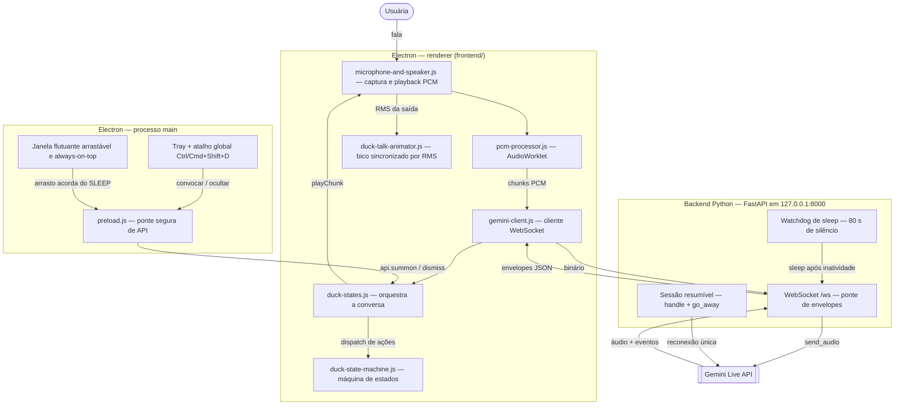

# Rubber Duck AI 🦆

POC de um pato de borracha com voz: um pato flutuante na tela, arrastável e convocável por atalho global de teclado, que conversa por voz com quem está estudando. A inspiração é a técnica de *rubber duck debugging* de *The Pragmatic Programmer* — explicar em voz alta para organizar o raciocínio — só que aqui o pato responde.

## O produto

|  |  |  |


A inspiração vem de *The Pragmatic Programmer* (Andrew Hunt e David Thomas, 1999): a técnica do **rubber duck debugging**, em que a pessoa programadora explica o próprio código em voz alta para um pato de borracha — o ato de verbalizar já organiza o raciocínio e frequentemente revela a resposta.

O Rubber Duck AI traz esse pato para a tela, com voz. Em vez de um objeto inerte, a conversa acontece de verdade — mas mantendo o espírito da técnica: quem explica é a usuária, e o pato pergunta antes de responder.

- **Pergunta antes de responder** — a usuária explica o que está estudando (código, conceito teórico, artigo) e o pato faz perguntas curtas.
- **Direciona no meio do caminho** — incentivo, sugestão de tentativa, apontamento de tópicos para pesquisar.
- **Marca hipóteses como chute** — na POC o pato não tem canal de verificação.
- **Pede re-elaboração** — a usuária explica a ideia de volta com as próprias palavras, consolidando o aprendizado.

O detalhamento completo de produto está no [PRD](docs/rubber-duck-prd.md).

## Segurança, privacidade e IA responsável

As [propostas de segurança, privacidade e IA responsável](docs/seguranca-privacidade-ia-responsavel.md)
explicam o tratamento de dados pelo Google, as responsabilidades do projeto e
as medidas propostas para a POC e sua evolução. O documento inclui critérios
de validação e decisões a tomar antes de ampliar o uso.

## Como funciona



Visão em texto, camada a camada:

1. **Electron renderer** — a UI do pato. `microphone-and-speaker.js` captura o microfone via `pcm-processor.js` (AudioWorklet) e envia os chunks PCM binários pelo WebSocket de `gemini-client.js`. O áudio de resposta chega em envelopes JSON, entra numa fila de reprodução (Web Audio) e o `duck-talk-animator.js` mede o RMS dessa saída para animar o bico. A conversa inteira é regida pela máquina de estados, que troca a arte do avatar conforme o status.
2. **Electron main** — janela flutuante arrastável e always-on-top, tray com ícone próprio e atalho global `CommandOrControl+Shift+D`. O renderer nunca acessa Node diretamente: tudo passa pela API exposta no `preload.js`.
3. **Backend Python (FastAPI)** — ponte WebSocket em `127.0.0.1:8000` entre o renderer e a Gemini Live API, única parte que conhece a chave de API. Mantém a sessão resumível (reconexão única após `go_away`), aplica o watchdog de sleep (80 s de silêncio com microfone ligado; mudo explícito pausa o contador) e serve os arquivos estáticos do frontend com CSP restritiva.
4. **Gemini Live API** — streaming bidirecional de áudio com o modelo; devolve a voz do pato e eventos de turno (interrupção, `turn_complete`).

Privacidade por construção: pato oculto não captura nada (microfone e sessão são encerrados), e o mute desliga a captura de verdade, sem track vivo.

## Estados do pato

A conversa é governada por uma máquina de estados ([`frontend/duck-state-machine.js`](frontend/duck-state-machine.js)):

| Estado | Descrição | Imagem |
|---|---|---|
| **OCULTO** | Pato escondido; nenhuma captura acontece. Acordar: atalho `CommandOrControl+Shift+D`.|
| **OUVINDO** | Sessão aberta, microfone ativo, aguardando a usuária começar a falar. |
| **PENSANDO** | A usuária terminou o turno; o pato processa a resposta. | 
| **FALANDO** | O pato responde por voz, com o bico sincronizado ao áudio. |
| **SLEEP** | Adormeceu após 80 s de silêncio (sessão encerrada). Acorda por atalho, arrasto ou clique na pílula.|
| **Sem escuta** (derivado) | Não é um sexto estado: é o microfone desligado (mudo, SLEEP ou OCULTO), refletido no botão da pílula. | — |

## Tecnologias

- **Backend:** Python 3.10+, FastAPI, WebSocket, [google-genai](https://pypi.org/project/google-genai/) (SDK da Gemini Live API), uvicorn, python-dotenv.
- **Frontend:** Electron 44, JavaScript vanilla (sem framework), Web Audio API (captura, reprodução PCM e análise de RMS para o bico), AudioWorklet.
- **Testes:** pytest (backend) e `node --test` (frontend), cobrindo análise do bico, pré-carregamento, interrupção, fila de reprodução, fim de turno, acessibilidade e limpeza.

## Como rodar

Pré-requisitos: Python >= 3.10 e Node >= 18, e uma chave da [Gemini API](https://aistudio.google.com/apikey).

1. Configure a chave (o servidor só escuta em `127.0.0.1`):

   ```sh
   cp .env.example .env
   # edite .env e informe GEMINI_API_KEY
   ```

2. Backend:

   ```sh
   python -m venv .venv
   .venv/bin/pip install -r requirements.txt
   .venv/bin/python main.py
   ```

3. Frontend (outra aba do terminal):

   ```sh
   npm install --prefix frontend
   npm start --prefix frontend
   ```

4. Convoque o pato com `CommandOrControl+Shift+D`.

## Bico sincronizado com a fala

O áudio da Gemini toca no renderer, por Web Audio. O módulo
`frontend/duck-talk-animator.js` mede o RMS da saída e troca apenas o `src`
do avatar, usando as três imagens já existentes. O microfone não alimenta
esse analisador.

Para calibrar, ajuste no topo desse módulo:

- `LIMIAR_1 = 0.02`: abaixo dele, o bico fica fechado.
- `LIMIAR_2 = 0.08`: a partir dele, o bico fica totalmente aberto.
- `MIN_FRAME_MS = 60`: duração mínima de cada frame durante a fala.
- `DEBUG = true`: mostra RMS bruto, volume suavizado e frame na janela.
  Reinicie o app após editar; volte para `false` ao terminar.

O frame usa o **volume suavizado**. Calibre os limites com essa leitura em
uma conversa real, incluindo pausas entre frases. São amplitudes do PCM,
não uma medida do volume físico do alto-falante.

Para testar manualmente:

1. Execute `npm start --prefix frontend` e convoque o pato com
   `CommandOrControl+Shift+D`.
2. Faça uma pergunta. Durante a resposta, confira os três frames, as pausas
   com o bico fechado e a ausência de piscadas ou mudanças de layout.
3. Interrompa a resposta falando. O bico deve fechar imediatamente; repita
   deixando uma resposta terminar normalmente.
4. Desligue o microfone durante uma resposta: a voz e o bico devem continuar.
   Ocultar o pato deve encerrar ambos.
5. Ative “Reduzir movimento” no sistema durante uma resposta: a voz continua,
   mas o pato fica parado, com o bico fechado. Desative para retomar a animação.

## Testes

```sh
npm test --prefix frontend
.venv/bin/python -m pytest -q
```

Cobrem análise, pré-carregamento, interrupção, fila de reprodução, fim de
turno, acessibilidade e limpeza.
